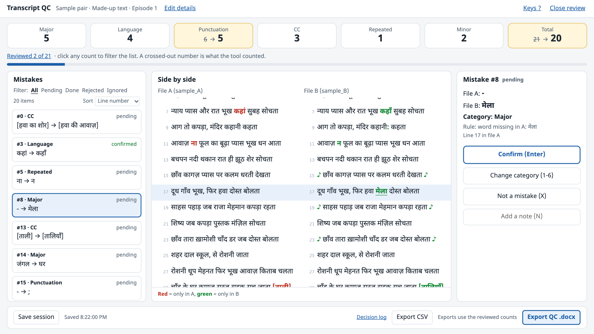

# Transcript QC

[](https://github.com/rahulshendre/transcript-qc/actions/workflows/ci.yml)

Compares two Hindi transcripts of one episode and counts the mistakes in the first one.
File A is the transcript being scored. File B is the corrected reference. The tool finds every
difference, sorts each into Major, Language, Punctuation, CC, Repeated or Minor, applies the
counting rules and writes:

* **QC document (.docx).** File A with every difference as a Word tracked change, and the 4x3 summary table at the end.
* **mistakes.csv.** One row per mistake with its category, the rule that decided it and a plain reason.
* **A review screen.** A reviewer checks the engine's count, fixes it where it is wrong, and exports the final table.



Runs offline on Windows, macOS and Linux. Nothing is sent anywhere.

## Docs

| Doc | For |
|---|---|
| [docs/WINDOWS.md](docs/WINDOWS.md) | Installing on Windows (installer or Python), building the installer |
| [docs/REVIEW_UI.md](docs/REVIEW_UI.md) | Using the review screen, keyboard keys, what is saved |
| [docs/HOW_IT_WORKS.md](docs/HOW_IT_WORKS.md) | What happens from two files in to QC document out |
| [docs/RULES.md](docs/RULES.md) | Every rule and setting in `rules.yaml` |
| [docs/ACCURACY_NOTE.md](docs/ACCURACY_NOTE.md) | Episode 50 results against the reviewer's table |
| [examples/](examples/README.md) | A made-up sample pair with known mistakes to try |

## Setup

Python 3.11 or newer.

macOS or Linux:

```
python -m venv .venv
.venv/bin/pip install -e .              # add ".[dev]" for tests and lint
```

Windows:

```
py -3.11 -m venv .venv
.venv\Scripts\pip install -e .
```

The commands below use the macOS form (`.venv/bin/python`). On Windows write `.venv\Scripts\python`.
For a Windows laptop without Python there is an installer: see [docs/WINDOWS.md](docs/WINDOWS.md).

## Try it

```
.venv/bin/python qc_compare.py --a examples/sample_A.docx --b examples/sample_B.docx --out out/sample_QC.docx
```

The sample pair is made-up text with 21 known mistakes, and the tool should count all 21.
See [examples/README.md](examples/README.md).

## Compare two files

```
.venv/bin/python qc_compare.py --a "LE1 BEK_50_Feltiv.sushila.docx" \
                               --b "LE2 BHARAT EK KHOJ_EP_50_Chandrakala.docx" \
                               --out out/ep50_QC.docx
```

This prints the six counts and the total, then writes `out/ep50_QC.docx` and `out/mistakes.csv`
and checks the file: Reject All must give A back and Accept All must give B.
Movie, writer and episode for the table are read from A's file name (`LE1 BEK_50_Feltiv.sushila.docx`
gives Bharat Ek Khoj, Sushila, 50). Override them with `--movie`, `--writer`, `--episode`.

| Flag | What it does |
|---|---|
| `--rules strict` | The assignment's rules applied literally. Default is the tuned `rules.yaml`. A path to your own rules file also works. |
| `--reference ep50` | Print the tool's counts next to a reference table. Also takes six numbers: `9,12,66,2,4,4`. |
| `--author NAME` | Author on every tracked change. Default `QC-Bot`. |
| `--show-diff` | Print every difference with its context. |

Exit code 0 is success, 2 is a file the tool cannot read or write (it says why), 1 is a failed round trip.
A missing output folder is created.

## Review screen

```
.venv/bin/python app.py                 # opens http://127.0.0.1:8765
```

Needs only Python. Nothing is fetched from the network, and reviews are saved in `~/Transcript QC/sessions`.
See [docs/REVIEW_UI.md](docs/REVIEW_UI.md).

## Rules

Which differences count, and how, is set in `transcript_qc/rules.yaml`, not in code. Copy it, edit it,
and pass it with `--rules`. `docs/RULES.md` explains each rule and switch.

## Accuracy

On Episode 50 the tool counts 174 against the reviewer's 97. Punctuation and Repeated are inside the allowed
range; Major, Language, CC, Minor and the total are not, so the acceptance bounds are **not met**.
The rules were tuned on this one episode. `docs/ACCURACY_NOTE.md` has the numbers and the reasons.

## Tests

```
.venv/bin/pytest                         # about 30 s
TRANSCRIPT_QC_SKIP_E2E=1 .venv/bin/pytest   # without the Chrome tests
cd frontend && npm test                  # screen logic
.venv/bin/ruff check .
```

The Chrome tests need Google Chrome. Tests that read the Episode 50 files look in `data/ep50/` and skip
when it is missing. The episode files are PlanetRead content and are not in the repo.

GitHub Actions runs the tests on Windows and Linux on every push, then builds the Windows installer,
installs it, starts it and checks it end to end on the sample pair (`packaging/smoke_test.py`).

To change the screen: `cd frontend && npm install && npm run build`. The build lands in
`transcript_qc/web/static`, which is committed so Node is not needed to run the app.

## Known limits

* **Reads body paragraphs only.** Tables and text boxes are not compared; the tool warns when a file has
  them. Headers and footers are ignored.
* **A file with tracked changes is refused.** Accept or reject them in Word first.
* **Tuned on one episode.** The thresholds in `rules.yaml` come from Episode 50. A second episode with its
  QC table is the test of whether they hold.
* **A run is one mistake, even across a line break.** If the last word of one line and the first word of
  the next are both wrong, they touch in the stream and count as one mistake (the brief's rule 1).
  Episode 50 has 7 such runs, all in the Sanskrit verse and crowd chants.
* **It cannot see intent.** B may cut a crowd chant or pick another sound tag on purpose. The tool counts
  some of those as mistakes; the review screen is where a person removes them.
* **Hindi only.** Spelling variants and vowel-length folding are written for Devanagari. Other scripts
  compare, but the Language rules will not fit.
* **QC document layout.** A line that exists only in B is inserted inside the nearest paragraph of A, not as
  a new paragraph, and a ♪ pair that sits between two lines lands at the end of the earlier one.
* **Word not tested.** Reject All and Accept All round-trip to 100.00 percent in code. The file opens in
  python-docx, macOS QuickLook and ONLYOFFICE, whose reader keeps all 344 insertions, 466 deletions, the
  summary table and the 11 embedded font parts of the Episode 50 file. It has not been opened in Word.
* **One reviewer, one machine.** The screen has no login and listens on 127.0.0.1 only.
* **Windows installer is not signed.** Windows shows "Windows protected your PC" once; More info, then
  Run anyway. It is checked on GitHub's Windows machines, not yet on a reviewer's own laptop.
* **Size.** Eight copies of Episode 50 (17,500 paragraphs) compare in about 4 seconds. Alignment slows
  sharply when the same few lines repeat thousands of times: 4,000 paragraphs made of 5 repeated lines took
  102 seconds. Real transcripts do not look like that, but a file full of identical refrain lines would be slow.

## Layout

| Path | Holds |
|---|---|
| `transcript_qc/reader.py`, `tokenize.py`, `align.py` | Read the files, split into words, tags and punctuation, find every difference |
| `transcript_qc/writer.py`, `revisions.py` | Write the tracked-change document and check the round trip |
| `transcript_qc/classify.py`, `count.py`, `rules.py` | Sort differences into categories and apply the counting rules |
| `transcript_qc/report.py`, `summary.py` | mistakes.csv and the summary table |
| `transcript_qc/review.py`, `sidebyside.py`, `web/` | Review session, side-by-side rows, API |
| `frontend/` | The review screen (React, Vite) |
| `packaging/` | Windows installer build and the end-to-end smoke test |
| `examples/` | Made-up sample pair |
