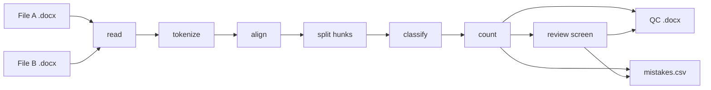

# How it works

One page on what happens between "two .docx files in" and "QC document out". Each step is one
module in `transcript_qc/`; the module's own docstring has the detail.

## 1. Read (`reader.py`)

Both files hold one subtitle line per paragraph, with blank paragraphs between lines. Every paragraph
is kept, blanks included, so a paragraph's position in the list is its position in the file. That
index is how each difference finds its way back to a line of A.

A file the tool would read wrongly is refused with a reason: not a .docx, or tracked changes still in
it. A file it would read only in part (tables, text boxes) gets a warning, so no text goes missing
without a word.

## 2. Tokenize (`tokenize.py`)

Each line is cut into tokens: a word, one punctuation mark, a ♪ marker, or a whole `[sound tag]`.
Every token remembers its paragraph and character position, so the writer can change exactly those
characters later and nothing else.

Words are found by elimination (anything that is not space, punctuation or a bracket), because
Python's `\w` does not match Devanagari vowel signs. That keeps matras, nukta, anusvara and
chandrabindu inside their word. Matching uses a Unicode-normalised copy; the original text is never
changed. Invisible characters (zero-width space, BOM, soft hyphen, direction marks) never count.

## 3. Align (`align.py`)

The whole file is aligned as one stream, not line by line, because A and B break lines in different
places: one line in A can be two in B.

Alignment runs in two passes. The first lines up only the content (words and sound tags). The second
compares the small gaps of punctuation and ♪ between matched words. Without this split, a comma could
pair with a comma two lines away and turn a simple spelling fix (कहां to कहाँ) into a delete plus an
insert.

## 4. Split hunks (`hunks.py`)

A difference that mixes a word change with a punctuation, ♪ or tag change is split in two, so each
part is counted under its own category.

## 5. Classify (`classify.py`)

Each hunk is checked against the rules in `rules.yaml`, top to bottom; the first rule that matches
decides the category. The rule id and a plain reason stay with the mistake, so every count can be
traced to the rule behind it. The rules and their order are in [RULES.md](RULES.md).

## 6. Count (`count.py`)

The brief's counting rules, in order:

1. One hunk, one mistake. A run of changed words is already one hunk.
2. Spaces between words and line breaks are never mistakes.
3. The same change (A text to B text) seen again and again is one Repeated mistake. Its other
   copies stay in the document but add nothing to any count.
4. One category per mistake.
5. The total is the sum of the six counts.

Some differences are deliberately not counted (song markers only in B, tags on one side only, line-break marks, long cuts).
They are kept as "ignored" so the review screen can show them and a reviewer can count any of them.

## 7. Write the QC document (`writer.py`, `summary.py`, `revisions.py`)

The QC file is built from A's own package. Only `word/document.xml` is rewritten, and only the
paragraphs with a difference, so A's fonts, styles and untouched lines stay exactly as they were. Each
difference becomes a Word revision: a deletion, an insertion, or both. The 4x3 summary table is
added at the end.

After writing, the file is read back as Word would after Reject All and Accept All. Reject All must
give A's text and Accept All must give B's. If either is below 99 percent the command fails.

## 8. Review (`review.py`, `sidebyside.py`, `web/`, `frontend/`)

The review screen loads the same analysis. Each count is just the number of rows behind it, so a
reviewer's decision (confirm, change category, not a mistake, add a missed one) moves the counts at
once. Every decision is saved to disk and logged with the time. The export uses the reviewed counts.
See [REVIEW_UI.md](REVIEW_UI.md).

## What runs where

Everything runs on the reviewer's computer. No paid service, no internet, no data leaves the machine.
The review screen is a small local web server (`127.0.0.1` only) and a page in the browser.
